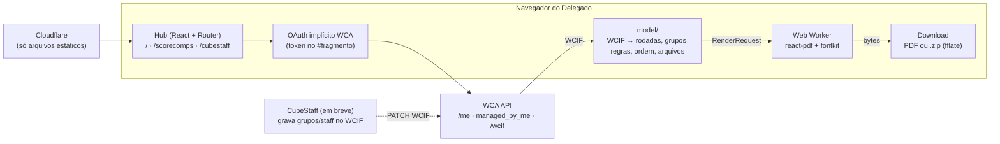

# Arquitetura

- **Contrato entre as ferramentas = WCIF da WCA.** O CubeStaff (assim como
  Groupifier e Delegate Dashboard) grava atividades `evento-rN-gK` e
  assignments; o ScoreComps só lê.
- **Mesmo código no navegador e no Node:** `pdf/core.tsx` recebe como ler as
  fontes e como transformar o documento em bytes; `scripts/render-samples.tsx`
  e `scripts/stress.tsx` geram PDFs idênticos aos do site.
- **Fontes sob demanda:** `pdf/fonts.ts` lê o manifesto de subconjuntos
  (`fontManifest.json`) e registra só o que os textos do PDF exigem.
